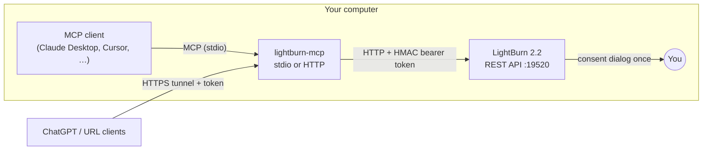

<div align="center">

# LightBurn MCP

**Talk to your LightBurn project from Claude, Cursor, ChatGPT and any other MCP client.**

Read the open project · explain and sanity-check cut settings · change them by sentence ·
apply materials from your library · drop AI-generated SVGs straight onto the workspace

[](https://github.com/DerChris2011/Lightburn_MCP/actions/workflows/ci.yml)
[](LICENSE)
[](https://nodejs.org/)
[](https://lightburnsoftware.com/)
[](https://modelcontextprotocol.io)

</div>

---

LightBurn 2.2 ships a local [REST API](https://github.com/LightBurnSoftware/LightBurn-REST).
This project wraps it as a [Model Context Protocol](https://modelcontextprotocol.io) server,
so an AI assistant can work *with* the LightBurn window you have open — on your machine,
with no account and no cloud in between.

```text
You:     Layer C02 is 10 mm/s at 80 %. Is that plausible for 3 mm poplar on my 40 W CO2?
Claude:  (reads get_project, get_units, get_cut 2) …that will likely char the edges.
         Want me to set 15 mm/s / 65 % and 2 passes? Review it in LightBurn before you run.
You:     Yes.
Claude:  (update_cut) Done – speed 15, max_power 65, num_passes 2.
         Review these settings in LightBurn before running the job.
```

## Table of contents

- [What it can do](#what-it-can-do)
- [What it cannot do](#what-it-cannot-do)
- [Quick start](#quick-start)
- [Connect your client](#connect-your-client)
- [ChatGPT and other URL-based clients](#chatgpt-and-other-url-based-clients)
- [Example prompts](#example-prompts)
- [Tools](#tools)
- [How it works](#how-it-works)
- [CLI reference](#cli-reference)
- [Troubleshooting](#troubleshooting)
- [Safety](#safety)
- [Development](#development)
- [License](#license)

## What it can do

| | Ask things like |
|---|---|
| 🧭 **Understand a project** | "What's in my project, which layers are used, what machine is selected?" |
| 🔍 **Check cut settings** | "Do any of my used layers look wrong for 3 mm plywood?" |
| ✏️ **Change settings by sentence** | "Set the red layer to 300 mm/s, 20 % and 2 passes." |
| 📚 **Apply library materials** | "Use my 3 mm acrylic cut setting on layer blue." |
| 🎨 **Import generated artwork** | "Make an 80×50 mm name tag with rounded corners and put it at 100,100." |
| 📡 **Read machine state** | position, job state and progress, overrides, jog settings, units |
| 📷 **Look through the camera** | the assistant can view the camera overlay LightBurn has loaded |

Works with **LightBurn** (port 19520) and **MillMage** (port 19521, untested so far).

## What it cannot do

The LightBurn API deliberately has **no machine control**: no start, stop, pause,
frame, jog or home. There is no shape editing, no layer assignment, no save, no export.
Changing cut settings edits the project only — **you** review it in LightBurn and run the
job. Every write tool says so in its result. Read [SAFETY.md](SAFETY.md) once.

## Quick start

**You need:** LightBurn 2.2.00 or newer running on this computer, and
[Node.js 20+](https://nodejs.org/) (the LTS installer is fine).

Start LightBurn, open a terminal (PowerShell on Windows, Terminal on macOS) and run:

```bash
npx github:DerChris2011/Lightburn_MCP setup
```

Setup walks you through four steps:

1. **Application** – `lightburn` (default) or `millmage`.
2. **Capabilities** – what the assistant may do. Default is all four:

   | Capability | Grants |
   |---|---|
   | `state` | read machine and job state |
   | `project` | read project data — *includes the camera overlay image* |
   | `upload` | import files into the project |
   | `project_write` | change cut settings |

3. **Pairing** – LightBurn pops up a consent dialog naming *LightBurn MCP* and the
   capabilities. Approve it within 30 seconds. The secret is stored in your user profile
   and never leaves your machine.
4. **Clients** – pick the MCP clients to configure. Their config files are updated with a
   backup kept next to them. Restart the client and you're done.

> The first `npx` run clones and builds the package (about a minute). After that your
> clients start the server directly, in well under a second.

Check anytime:

```bash
npx github:DerChris2011/Lightburn_MCP status
```

```text
Product:      lightburn
Host:         localhost:19520
Reachable:    yes
Paired:       yes (secret source: file)
Capabilities: state, project, upload, project_write
```

## Connect your client

`setup` does this for you. To (re)do a single client:

```bash
npx github:DerChris2011/Lightburn_MCP config <client> --write
```

| Client | `<client>` | Notes |
|---|---|---|
| Claude Desktop | `claude-desktop` | restart Claude Desktop afterwards |
| Claude Code | `claude-code` | prints the `claude mcp add …` command (setup runs it when the CLI is installed) |
| Cursor | `cursor` | |
| Windsurf | `windsurf` | |
| VS Code (Copilot) | `vscode` | user-level `mcp.json` |
| Gemini CLI | `gemini-cli` | |
| Anything else (stdio) | — | `config cursor` prints the exact command and args to paste |

Full JSON for every client, Windows and macOS, is in [docs/clients.md](docs/clients.md).

## ChatGPT and other URL-based clients

ChatGPT adds MCP servers as *connectors* and only accepts a public HTTPS URL — it cannot
start a local process and rejects `localhost`. For that the server has an HTTP mode that
**always requires an access token**:

```bash
npx github:DerChris2011/Lightburn_MCP --http
# LightBurn MCP listening on http://127.0.0.1:3917/mcp
# Token required: header "Authorization: Bearer <token>" or URL http://127.0.0.1:3917/mcp/<token>
```

Clients that can send headers use the bearer header (Claude Code:
`claude mcp add --transport http lightburn http://127.0.0.1:3917/mcp --header "Authorization: Bearer <token>"`).
ChatGPT can't, so put the token in the URL and a tunnel in front:

```bash
ngrok http 3917            # or: cloudflared tunnel --url http://127.0.0.1:3917
```

Add `https://<your-tunnel-host>/mcp/<token>` as a custom connector in ChatGPT
(Settings → Connectors, Developer Mode, eligible plans only). Show the token with
`lightburn-mcp token`, rotate it with `lightburn-mcp token --rotate`.

> ⚠️ **The tunnel URL is a secret.** Anyone who has it can read your project and change
> cut settings. Stop the tunnel when you're done. LightBurn Software does not endorse
> remote machine operation — see [SAFETY.md](SAFETY.md).

## Example prompts

- "Summarise my current LightBurn project: layers in use and their settings."
- "Compare every used layer against my material library and tell me which ones differ."
- "Set every layer that is in use to 2 passes."
- "Apply the *Plywood 3 mm* entry from my library to layer 2."
- "Create a 60 mm circle with the text *Workshop* inside as SVG and import it at 50,50, top-left origin, grouped."
- "Is the machine connected, and what are the current speed and power overrides?"
- "Show me the camera overlay and tell me where the material is."

## Tools

| Tool | Capability | What it does |
|---|---|---|
| `pair` | — | Pair with LightBurn (consent dialog); stores the secret |
| `connection_info` | — | Product, host, port, paired?, capabilities, reachable? |
| `get_status` | state | Device name, connected flag, supports_z / overrides |
| `get_position` | state | Machine and workpiece coordinates (mm) |
| `get_units` | state | Display units for speed and distance |
| `get_jog_settings` | state | Jog distance / speed settings |
| `get_saved_positions` | state | Saved positions from the device profile |
| `get_state_snapshot` | state | Position, job, overrides, aux, connection in one call |
| `get_project` | project | Filename, shape count, workspace, device and laser capabilities |
| `get_layers` | project | Layer definitions (in-use only by default) |
| `get_cuts` | project | Cut settings (compact, in-use only by default) |
| `get_cut` | project | One cut entry with every field |
| `get_material_library` | project | The loaded material library |
| `get_camera_overlay_metadata` | project | Overlay size, placement, revision |
| `get_camera_overlay` | project | The camera overlay as a PNG image |
| `update_cut` | project_write | Partial update of one cut entry (one undo step in LightBurn) |
| `apply_material_to_cut` | project + project_write | Copy a library entry onto a cut; refuses ambiguous matches |
| `upload_file` | upload (+ state) | Import a file or generated content, with placement (x, y, origin, grouping) |
| `open_file` | upload (+ state) | Replace the project with a file |

Values follow LightBurn's display units (`get_units`). Every write tool ends with
*"Review these settings in LightBurn before running the job."*

## How it works



- **Pairing** calls `POST /api/connect`; LightBurn shows the consent dialog and returns a
  secret. The server stores it in `%APPDATA%\lightburn-mcp\config.json` (Windows) or
  `~/Library/Application Support/lightburn-mcp/config.json` (macOS).
- **Every request** carries `hex(HMAC-SHA256(secret, floor(unix_time / 60)))` as a
  bearer token, exactly as the API specifies. A rejected token is retried once, then the
  tool asks you to re-pair.
- **Imports** open LightBurn's event stream *before* sending the file, so the
  `file_imported` result is reported back instead of a bare "accepted".
- **Nothing is cached**: every tool call reads live from LightBurn.

Environment variables override the stored config for advanced setups — for example a
server on another machine using a secret copied from *Manage API Security* in LightBurn:
`LIGHTBURN_SECRET`, `LIGHTBURN_HOST`, `LIGHTBURN_PRODUCT`, `LIGHTBURN_MCP_CONFIG_DIR`.

## CLI reference

```text
lightburn-mcp                      Start the MCP server on stdio
lightburn-mcp --http [--port N] [--host H] [--token T]
                                   Start over Streamable HTTP (token always required)
lightburn-mcp setup                Interactive: pair + configure clients
lightburn-mcp pair [--capabilities state,project,upload,project_write]
lightburn-mcp status               Pairing state, reachability
lightburn-mcp config <client> [--write]
lightburn-mcp token [--rotate]     Show or rotate the HTTP access token
lightburn-mcp --version | --help
```

(`npx github:DerChris2011/Lightburn_MCP <command>` works without installing;
`npm install -g github:DerChris2011/Lightburn_MCP` gives you the `lightburn-mcp` command.)

## Troubleshooting

| Symptom | What's going on |
|---|---|
| *LightBurn does not appear to be running* | LightBurn must be open. It serves the API on port 19520 (MillMage 19521); the port can't be changed. |
| *LightBurn rejected the token* / 401 | The pairing was revoked, lacks the capability, or belongs to another LightBurn window. Run `pair` again. With several windows open, the most recently focused one serves the API. |
| Pairing times out | The consent dialog is in LightBurn's main window and closes after 30 s. Bring LightBurn to the front and run `pair` again. |
| *The cut settings editor is open* | Close the Cut Settings Editor window in LightBurn and retry. |
| Server stopped starting after a Node upgrade or `npm cache clean` | Client configs point at the Node binary and package folder found during setup (GUI apps have no PATH). Re-run `config <client> --write`, or install globally and use `lightburn-mcp` as the command. |
| Running the server on another machine | Pair on the LightBurn machine, enable *Settings → Extensions → Allow API Access From Network*, copy the secret via *Manage API Security → Show Secret…*, start the server with `LIGHTBURN_SECRET=… LIGHTBURN_HOST=<ip>`. Windows may ask once for a firewall rule. |
| `connected: false` although the laser is on | Normal on Ruida and similar controllers: the link is opened only during transfers. It is not a fault. |

## Safety

Cut settings control laser power, speed and passes. **Review every setting the assistant
touched in LightBurn before you press Start.** The API cannot start or stop a machine,
this server adds no such ability, and it is not a safety system. LightBurn Software does
not endorse remote or unattended operation. Details in [SAFETY.md](SAFETY.md).

## Development

```bash
git clone https://github.com/DerChris2011/Lightburn_MCP.git
cd Lightburn_MCP
npm install
npm test            # 90+ tests against an in-process mock of the LightBurn API
npm run build
node dist/index.js --help
```

TypeScript, `@modelcontextprotocol/sdk`, `zod`, `express`; tests with Vitest. CI runs on
Windows and macOS. The design document and implementation plan live in
[docs/superpowers/](docs/superpowers/). Issues and pull requests are welcome.

## License

MIT © DerChris2011. The LightBurn / MillMage API is governed by LightBurn Software's
[API EULA](https://github.com/LightBurnSoftware/LightBurn-REST/blob/main/API-EULA.md).
This project is not affiliated with or endorsed by LightBurn Software.
